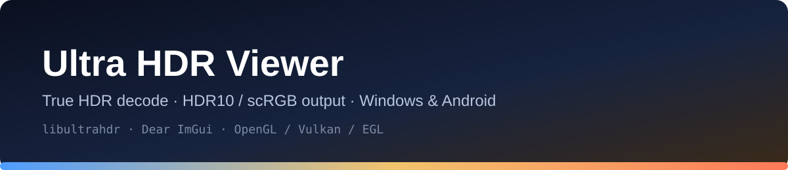
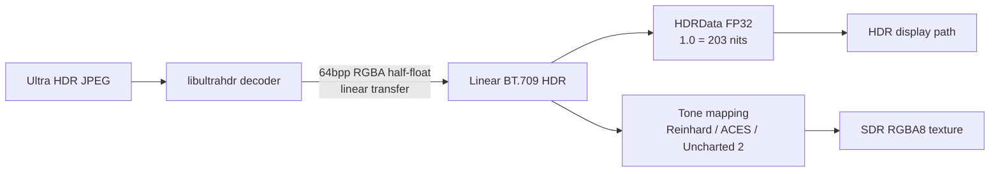
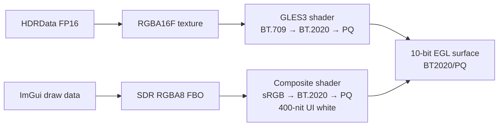
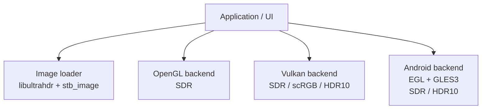

<p align="center">
  
</p>

<p align="center">
  
  
  
  
</p>

A true-HDR image viewer built with [Dear ImGui](https://github.com/ocornut/imgui) and
[libultrahdr](https://github.com/google/libultrahdr). It decodes the Ultra HDR gain map at full
boost, keeps highlights above SDR white, and can present them directly on HDR-capable displays.

---

## Screenshots

| SDR view (tone-mapped) | HDR10 direct output |
|---|---|
|  |  |
| 3072×4096 image, Reinhard tone mapping, HDR output off | Ultra HDR test image, HDR10 BT.2020/PQ, peak 1635 nits |

> Screenshots are captured on an Android 17 phone with **generated gradient test images** — no personal photos.
> The HDR capture reads the raw PQ buffer, so its brightness is not representative of the physical display.

## Highlights

| Area | What you get |
|---|---|
| **Decode** | `UHDR_IMG_FMT_64bppRGBAHalfFloat` + `UHDR_CT_LINEAR`, gain map applied at full boost |
| **HDR data** | Linear BT.709 float RGBA, `1.0 = 203 nits`, real highlights above SDR white |
| **Desktop output** | scRGB (FP16) preferred, HDR10 (PQ/BT.2020) fallback, Vulkan only |
| **Android output** | 10-bit EGL surface, `EGL_GL_COLORSPACE_BT2020_PQ_EXT`, RGBA16F texture, PQ shader |
| **Tone mapping** | Reinhard / ACES Filmic / Uncharted 2, exposure and gamma controls |
| **UI** | Dear ImGui; on Android the UI is composited from an SDR buffer into PQ to keep its colors |
| **Input** | Zoom, pan, fit-to-window; mouse on desktop, touch gestures on Android |
| **Files** | Drag-and-drop / native dialog on desktop; SAF picker and `ACTION_VIEW`/`ACTION_SEND` on Android |
| **Metadata** | EXIF camera info plus SMPTE 2086 / CTA-861.3 HDR metadata on Android |

## Supported platforms

| Platform | Renderer | HDR output | Notes |
|---|---|---|---|
| Windows | OpenGL 3.0 | — | SDR-only by design (WGL has no HDR swapchain) |
| Windows | Vulkan | scRGB / HDR10 | Preferred for HDR displays |
| Android | EGL + OpenGL ES 3 | HDR10 (BT.2020/PQ) | Requires an HDR10 display and a device/driver exposing the EGL PQ extension |

## How it works

### True HDR decode



### Android HDR10 output



The UI is rendered into an SDR offscreen buffer first, so panel colors and alpha blending behave
exactly like SDR. A final full-screen pass converts the UI to PQ and composites it over the HDR image.

### Backend layout



## Dependencies

| Library | Version | Purpose |
|---|---|---|
| GLFW | 3.4 | Window/input management (desktop) |
| Dear ImGui | v1.91.8 | GUI framework |
| libultrahdr | v1.4.0 | Ultra HDR decoding |
| libjpeg-turbo | 3.0.1 | JPEG codec used by libultrahdr |
| Vulkan SDK | 1.0+ | Vulkan backend (optional, desktop) |

Android rendering uses the platform **EGL + OpenGL ES 3** APIs directly; SDL2 is not required.

## Building

### 1. Clone dependencies

```bat
clone_deps.bat
```

```bash
# Linux/macOS
./clone_deps.sh
```

This downloads GLFW, Dear ImGui, libultrahdr, libjpeg-turbo and stb_image into `deps/`, and applies
the CMake patches needed for sub-project builds.

### 2. Desktop (Windows)

```bat
:: Configure
cmake --preset vs2026-opengl

:: Build (Debug or Release)
cmake --build out/build/vs2026-opengl --config Release

:: Run
out\build\vs2026-opengl\bin\Release\UltraHDRViewer.exe
```

Vulkan backend (HDR output):

```bat
cmake --preset vs2026-vulkan
cmake --build out/build/vs2026-vulkan --config Release
out\build\vs2026-vulkan\bin\Release\UltraHDRViewer.exe --vulkan
```

Ninja presets are also available: `ninja-debug` and `ninja-release`.

### 3. Android (Android 17 / API 37)

The repository includes a setup script that installs a project-local toolchain into `.tools/`
(no system-wide changes):

```powershell
powershell -ExecutionPolicy Bypass -File android\setup_android_sdk.ps1
```

Build and install:

```powershell
cd android
$env:JAVA_HOME="$PWD\..\.tools\jdk-17"
.\gradlew.bat assembleDebug

# APK: android/app/build/outputs/apk/debug/app-debug.apk
adb install -r app\build\outputs\apk\debug\app-debug.apk
```

Android toolchain:

| Item | Version |
|---|---|
| JDK | 17 (Temurin) |
| Android Gradle Plugin | 9.1.1 |
| Gradle | 9.3.1 |
| compileSdk / targetSdk | 37 (Android 17) |
| minSdk | 24 |
| Build-Tools | 36.0.0 / 37.0.0 |
| NDK | 28.2.13676358 |
| CMake | 3.22.1 |
| ABI | `arm64-v8a`, `x86_64` |
| 16 KB page size | Supported (AGP 9.1 + NDK r28, aligned ELF segments) |

#### Using the Android app

- Tap **Open Image** (or the empty image area) to pick a file through the system document picker.
- Images can also be opened from a file manager or share sheet (`ACTION_VIEW` / `ACTION_SEND`).
- Single-finger drag pans, pinch zooms, double-tap resets to fit.
- **HDR Output (PQ)** is enabled automatically for Ultra HDR images on HDR10-capable displays.
- The controls panel adapts to portrait and landscape layouts.

## Command Line Options (Desktop)

| Option | Description |
|---|---|
| `--opengl`, `-g` | Use OpenGL backend (default) |
| `--vulkan`, `-v` | Use Vulkan backend |
| `--width N` | Window width |
| `--height N` | Window height |
| `--help`, `-h` | Show help |

## Keyboard Shortcuts (Desktop)

| Shortcut | Action |
|---|---|
| `Ctrl+O` | Open file |
| `Ctrl+S` | Save as SDR image |
| `F` | Fit to window |
| `R` | Reset view |
| `I` | Toggle info panel |
| `H` | Toggle HDR output (HDR display + Vulkan only) |
| `Esc` | Exit |

## HDR Display Output

### Desktop (Vulkan only)

- **Requirements**: Vulkan backend (`--vulkan`), an HDR-capable display with HDR enabled in Windows,
  and an image with real HDR data.
- **Toggle**: `H` or *View → HDR 输出*. scRGB (FP16 linear) is preferred; HDR10 (PQ/BT.2020) is the
  fallback. Moving the window to an SDR display falls back to SDR automatically.
- **OpenGL is SDR-only by design**: WGL has no HDR swapchain mechanism, so HDR output is impossible
  on that backend.
- **Testing on an SDR machine**: set `UHDR_MOCK_HDR_OUTPUT=scrgb` (or `hdr10` / `both`) to exercise the
  full activation path; the real swapchain stays SDR and values above 1.0 are clamped.

### Android (HDR10 / PQ)

- **Requirements**: an HDR10-capable Android display and an Ultra HDR image with real HDR data.
- **How it works**: a 10-bit EGL window surface is created with
  `EGL_GL_COLORSPACE_BT2020_PQ_EXT`; the decoded image is uploaded as an RGBA16F texture and converted
  from linear BT.709 to BT.2020 / ST2084 (PQ) in a GLES3 shader. SMPTE 2086 and CTA-861.3 metadata are
  published when the driver exposes the extensions.
- **Toggle**: **HDR Output (PQ)** in the controls panel. It is enabled automatically for Ultra HDR
  images and disabled for SDR images.
- **Fallback**: if `EGL_EXT_gl_colorspace_bt2020_pq` or a 10-bit EGL config is unavailable, the app
  stays on the SDR path and disables the toggle.
- **UI**: ImGui renders into an SDR RGBA8 offscreen buffer; a final shader converts it
  (sRGB → BT.2020 → PQ at a 400-nit UI white point) and composites it over the HDR image.

## Testing

Host unit tests (decode, tone mapping, EXIF, color math):

```powershell
cmake --preset vs2026-opengl
cmake --build out/build/vs2026-opengl --config Debug
ctest --test-dir out/build/vs2026-opengl -C Debug --output-on-failure
```

Android-specific host tests (`AndroidLoaderTests`) verify that the Android decoder really produces
values above SDR white (`maxLinear > 1.0`). Device verification was performed on an Android 17 phone
with an HDR10 display (3200-nit peak): 10-bit BT.2020/PQ activation, a 3072×4096 Ultra HDR photo,
HDR toggling, file opening, gestures, rotation and lifecycle transitions all passed.

Static APK checks:

```powershell
# targetSdk / ABI
.tools\android-sdk\build-tools\37.0.0\aapt2.exe dump badging android\app\build\outputs\apk\debug\app-debug.apk

# 16 KB zip alignment
.tools\android-sdk\build-tools\37.0.0\zipalign.exe -c -P 16 -v 4 android\app\build\outputs\apk\debug\app-debug.apk

# ELF LOAD segments should show align 2**14
.tools\android-sdk\ndk\28.2.13676358\toolchains\llvm\prebuilt\windows-x86_64\bin\llvm-objdump.exe -p lib\arm64-v8a\libuhdrviewer.so
```

## Project Structure

```
UltraHDRViewer_Imgui/
├── CMakeLists.txt            # Desktop CMake configuration
├── CMakePresets.json         # VS 2026 / Ninja presets
├── clone_deps.bat / .sh      # Dependency cloner
├── docs/images/              # README banner and screenshots
├── src/                      # Desktop source
│   ├── main.cpp              # Entry point
│   ├── app.h / app.cpp       # Application logic + UI
│   ├── renderer.h            # Renderer interface + ImageData/HDRData
│   ├── renderer_gl.h/cpp     # OpenGL backend (SDR)
│   ├── renderer_vk.h/cpp     # Vulkan backend (scRGB / HDR10)
│   ├── colorspace.h          # PQ / BT.2020 / nit math
│   ├── half_float.h          # half ↔ float conversion
│   ├── image_loader.h/cpp    # True HDR decode
│   ├── tonemap.h/cpp         # Tone mapping
│   ├── exif_parser.h/cpp     # EXIF parser
│   ├── file_dialog.h/cpp     # Win32 file dialog
│   └── shaders/              # HDR quad shaders + SPIR-V headers
├── tests/                    # GoogleTest suites
└── android/
    ├── setup_android_sdk.ps1 # Installs JDK/SDK/NDK/CMake into .tools/
    ├── app/
    │   ├── build.gradle      # AGP 9.1, NDK 28.2, targetSdk 37
    │   └── src/main/
    │       ├── AndroidManifest.xml
    │       ├── java/com/uhdrviewer/MainActivity.java
    │       └── cpp/
    │           ├── CMakeLists.txt           # turbojpeg + libultrahdr + ImGui (GLES3)
    │           ├── native.cpp               # EGL/GLES render thread, touch, UI
    │           ├── egl_context.cpp          # HDR10/SDR EGL surface + metadata
    │           ├── hdr_gles.cpp             # PQ image shader + SDR UI FBO compositor
    │           ├── hdr_types.h              # Shared data structures
    │           ├── image_loader_android.cpp # True HDR decode
    │           └── exif_parser_android.cpp  # EXIF parsing
    └── gradle/              # Gradle 9.3.1 wrapper
```

## License

- Dear ImGui: MIT License
- libultrahdr: Apache 2.0 License
- GLFW: zlib/libpng License
- libjpeg-turbo: BSD-style / IJG licenses
